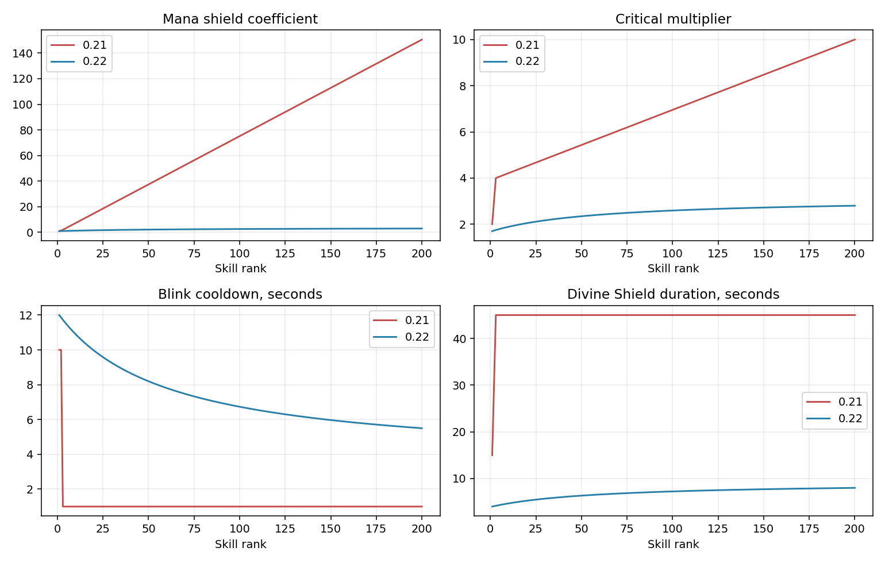

# Баланс Four Fronts Frenzy 0.22.0

[Карта](../releases/FourFrontsFrenzy-0.22.0-alpha.w3x) · [Все 50 героев и 200 навыков: числа по рангам](balance/All-skills.md) · [Excel CSV](balance/All-skills.csv) · [Описание механик](Heroes-and-skills.md).

Переработаны кривые навыков, сила призывов, защита, восстановление ресурсов и исходные характеристики дополнительных героев. Основная причина перекосов — прежняя экстраполяция стандартных трёх уровней Warcraft на 200: многие коэффициенты вырастали в десятки раз, некоторые способности переставали меняться после третьего ранга, а количество призывов дополнительно умножало их растущие характеристики.

Это анализ данных и исполняемых обработчиков карты. Движок Warcraft III здесь недоступен: результаты матчей, реальные проценты побед и полное отсутствие сильных/слабых героев не подтверждены. Новые пределы дают проверяемую основу для игрового теста, а не обещание одинаковой эффективности во всех ситуациях.

## Найденные перекосы и исправления

Числа ниже — поля фактически собранных карт 0.21 и 0.22, на максимальном ранге соответствующего навыка.

| Механика | Было | Стало | Зачем |
|---|---:|---:|---|
| Щит маны: поглощение на единицу маны | 150,5 | 3 | Убрать практически бесплатную огромную защиту |
| Крит мастера клинка: шанс / множитель | 60% / ×10 | 32% / ×2,8 | Средний множитель обычных атак меняется с ×6,4 на ×1,576 |
| Иллюзии: совокупный урон всех копий | 1840% героя | 220% героя | Количество копий сохранено, урон делится между ними |
| Иллюзии: получаемый урон | 100% | 300% | Копии полезны для давления, но их можно уничтожать |
| Уклонение обычного навыка | 75% | 50% | Поддержать физические атаки как способ противодействия |
| Смертельный союз: коэффициент лечения | 300 | 3,5 | Убрать бессмысленный избыток лечения |
| Порча: доля максимального HP в секунду | 24,5% | 3,5% | Не уничтожать любые армии и здания за несколько тиков; по зданиям множитель 0,2 |
| Божественный щит: длительность / КД | 45 / 53 с | 8 / 22 с | Остаются заметные окна уязвимости |
| Скачок: КД / дальность | 1 с / 1150 | 5,5 с / 1400 | Все ранги развивают мобильность без постоянного мгновенного ухода |

У большинства основных умений рост быстрее в начале и постепенно замедляется. Для ранга r и максимума M используется нормированная кривая `((r−1)/(r−1+60))/((M−1)/(M−1+60))`; у ряда ультимативных эффектов рост линейный. Каждый эффект имеет собственные начальную величину и предел в [balance-profiles.json](../map/balance-profiles.json). Это конечные нативные значения после прежних множителей, поэтому повторное умножение не разгоняет их незаметно.

## Все навыки и роли героев

Проверены **200 основных слотов у 50 героев**, включая авторских персонажей. Для обычных навыков проверены ранги 1–200, для ульт 1–50: всего **32 300 переходов между соседними рангами**. Переходов без изменения отслеживаемого числового или триггерного эффекта не найдено. Это не означает, что каждое отдельное поле меняется каждый ранг: количество существ меняется по прежним ступеням, а целочисленные параметры округляются. Иногда ранг улучшает перезарядку или длительность вместо урона. Полная таблица показывает конкретные значения и не подменяет их текстом подсказки.

Для ударных заклинаний отдельно заданы урон цели и общий предел урона по нескольким целям. Для периодических атак — урон за нативный интервал; сами технические интервалы не подменяются. Для контроля ограничена продолжительность относительно КД: у проверяемых основных оглушений/удержаний не больше 31%, у Божественного щита — 37%. Это ограничения отдельного навыка; несколько героев всё ещё могут комбинировать контроль.

Ауры сохраняют свою роль усилителей армии и полезные начальные значения: например, аура смерти даёт 6 HP/с и 15% передвижения уже с первого ранга; аура благочестия — 6 брони; чародейство — 3 маны/с. Поддержка ценна за действие сразу на много союзников, поэтому её нельзя оценивать только одиночной дуэлью. Сохраняются различия между ближними и дальними героями, лечением, осадой, контролем и усилением солдат.

У Повелителя огня исправлено Испепеление: вместо варианта стрелы без нужных числовых данных используется отдельная настоящая пассивная способность. Накопительный урон удара растёт 2→20, взрыв — 50→800, половинный урон — 25→400. Способность изучается обычным способом, в том числе ботами.

У Знаменосца крови каждый из 200 рангов теперь действительно повышает нативный вампиризм: 12→32%; со знаменем максимум 42%. Ранее округление вспомогательной способности создавало ранги без реального прироста. Проверяется применение ауры к союзнику и снятие после гибели источника.

## Призывы и иллюзии

**Количество существ не уменьшено**: сохранены все прежние ступени дополнительных питомцев, энтов, скелетов, иллюзий и воскрешённых. Энты Хранителя рощи по-прежнему вызываются без деревьев. Сохранены время жизни, модели, размеры, награда за убийство и учёт вне лимита обученных солдат.

Обычные призывы получают конечные коэффициенты роста HP до ×5,5 и базового урона до ×6 относительно начальной основы; ультимативные — до ×5. Ранее добавленные стартовые коэффициенты отдельных семейств учитываются отдельно. Чёрная стрела имеет более осторожные пределы скелетов. Прирост распределяется с учётом дополнительных существ: бюджет делится на `1 + 0,08 × число добавленных существ`. Это сдерживает одновременное умножение численности и силы каждого бойца. При ступени нового существа отдельный питомец может немного ослабнуть; оценивать нужно весь призыв. Урон и HP в таблице — сумма базовых характеристик за один вызов, а не DPS или число всех одновременно живущих существ. Для фабрики роботы и сама фабрика учитываются отдельно.

Вторичные эффекты призывов, например огненная аура, тоже имеют конечную прогрессию вместо прежнего разгона почти в десять раз. Лимит вызовов и существующие длительности остаются прежними.

## Характеристики, предметы и экономика

У дополнительных героев базовые HP раньше сами по себе превышали основу стандартных героев, поверх бонуса от силы. Основа большинства приведена к 100 HP; у тонких Серебряной лучницы и Кобольда — 60 и 80. Стартовая сумма трёх характеристик ограничена 64, каждая — 28. Родные стартовые характеристики 24 стандартных героев сохранены. HP от силы остаются прежними: +30 за единицу.

На сотнях уровней прежняя броня от ловкости и предметов чрезмерно обесценивала обычные атаки и усиливала героев ловкости сразу по нескольким направлениям. Изменены глобальные коэффициенты:

| Параметр | Было | Стало |
|---|---:|---:|
| Броня за ловкость | 0,30 | 0,08 |
| Базовая поправка брони от ловкости | −2 | 0 |
| Скорость атаки за ловкость | 2% | 1% |
| Коэффициент положительной брони | 0,06 | 0,025 |
| Броня обычной экипировки трёх ступеней | 10 / 25 / 60 | 6 / 12 / 24 |
| Броня сверхпредмета | 200 | 55 |
| Бонус регенерации маны трёх ступеней | 100 / 250 / 500% | 50 / 100 / 180% |
| Бонус регенерации маны сверхпредмета | 2000% | 300% |
| Плоская регенерация HP сверхпредмета | 200/с | 120/с |

При положительной броне A доля входящего физического урона — `1/(1+k×A)`. Изменение k ослабляет и броню солдат, не только героев: это намеренная общая коррекция затяжных боёв. Цена и величина каждого исследования армии сохранены, включая +4 атаки, +1,5 брони и +10% HP. Для брони эффективность в бою изменяется через общую формулу.

Все цены предметов и исследований, доход, награды и бюджетные тактики ботов сохранены. Керри продолжают ориентироваться на экипировку, поддержка — больше на армию. Новая сила вещей и героев меняет результат покупок; поведение ИИ не заменяется фиктивным «идеальным» подбором без данных матчей.

Центральный фонтан восстанавливает 0,35% максимальных HP и 0,4% маны в секунду вместо 1,5% обоих ресурсов. Это оставляет смысл урону и истощению маны при боях в центре. Союзные фонтаны баз остаются на 0,5%. Бастион имеет 700 базового урона и интервал 0,5 с вместо 1750/0,2 с; HP 156 000, дальность 1400 и защитное включение сохранены. Номинальная частота/урон — не измеренный в движке DPS.

## Технические исправления и проверка

Исправлена запись времени замаха/восстановления атаки: раньше использовались идентификаторы полей целей/радиуса splash. Теперь используются настоящие `udp1/udp2` и `ubs1/ubs2`. У формы Химической ярости базовый интервал связан с фактическим бонусом 20→125%. У расового яда исправлен тип нативного числового флага. Все изменяемые поля проверяются по замороженным метаданным Classic; сборка не зависит от скачивания этих данных.

`npm test` проверяет MPQ с независимым чтением секторов, бинарные структуры, 12 слотов и четыре команды, 499 633 нативных поля и 53 700 значений кривых, пределы контроля/защиты, все количества призывов, цены, модели и неизменность мира относительно опубликованной 0.21. Дополнительно выполняются проверки реальных обработчиков через имитацию natives: изучение навыков всеми ботами, покупки, исследовательская очередь, призывы, награды, смерть/возрождение, уборка эффектов, приказы армии через центр и новые 200 ступеней вампиризма. Проверяется связность всех проходов. Строгий legacy pjass проверяет JASS против Classic API.

Исторические числовые проверки старых релизов оставлены в репозитории для справки. Их ожидания прежнего баланса заменены текущим независимым `verify-022.cjs`; прежние проверки игровых обработчиков продолжают выполняться. Приказы армии и ИИ, цены исследований, все численности, данные ландшафта, слоты и роли сохраняются сравнением с опубликованным архивом.

Сохранены 6 солдат за начальную волну, интервал 18 секунд, предел 85 обученных бойцов, 500 уровней героя, 200/50 рангов навыков, отдельный «+» на +2 характеристик, автосохранение раз в 120 секунд и возрождение через 35 секунд. Новых периодических таймеров, групп и обработчиков этой балансировкой не добавлено.

## Что проверять в настоящих матчах

Начать новую игру. Для проверки прогрессии нужны ранние, средние и поздние бои с сопоставимой стоимостью экипировки и исследований, а не только одинаковым уровнем героя. Особое внимание: Иллидан против физического керри; Нагa со щитом против магов; призыватель/Архимаг против массового урона; аурная поддержка с армией против героя с предметами; атака крепости армией под огнём бастиона. Нужно проверить и ранние ранги, и максимальные — максимум ульты открывается лишь на уровне героя 496.

Для следующих корректировок полезны длительность боя, нанесённый/полученный урон, число погибших солдат, стоимость сборок и доступность отступления. Серия из 10–20 матчей разных составов обнаружит практические перекосы, но ещё не даст надёжной статистики побед для 50 героев. Без игровых результатов здесь не присваивается фиктивный рейтинг силы и не заявляется идеальный баланс.
