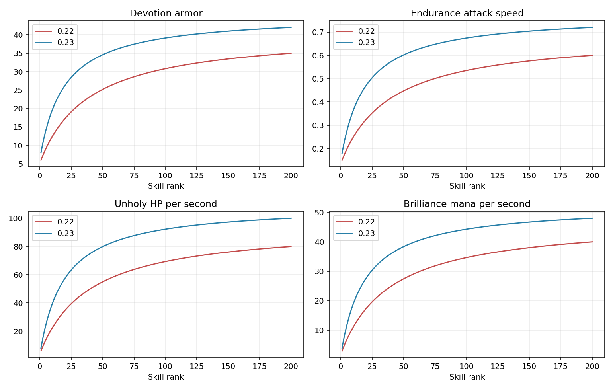

# Магазины, усиленные ауры и боты — 0.23.0

[Скачать карту](../releases/FourFrontsFrenzy-0.23.0-alpha.w3x) · [Все 200 навыков по уровням](balance-0.23/All-skills.md) · [CSV](balance-0.23/All-skills.csv).

## Два магазина в центре

«Реликвии арены» находится слева от фонтана, «Печати и эликсиры» — справа, немного выше его. Они общие для всех четырёх команд. Выбрать магазин можно командами `-relics` и `-buffs`. К прежним магазинам и фонтану остаются проходы.

| Предмет | Цена | Эффект |
|---|---:|---|
| Клык сумерек | 8400 | +80 урона, +20% скорости атаки, 12% вампиризма обычных атак. Реликвия для керри. |
| Зеркальная призма | 8000 | +40 интеллекта, +1200 маны. Автоматически блокирует одно подходящее направленное заклинание раз в 25 секунд. Не защищает от площадных атак. |
| Пепельное сердце | 8400 | +3000 HP, +8 брони. Обжигает наземных врагов в радиусе 300: 45 урона/с. Для передовой. |
| Знамя искр | 7600 | +1500 HP, +500 маны. Аура +15% скорости атаки союзным солдатам и призывам в радиусе 900. Не действует на героев; одноимённые ауры не складываются. |
| Печать натиска | 1500 | На 15 секунд даёт +60% урона союзным солдатам и призывам в радиусе 750. Не действует на героев. Один заряд; КД 45 секунд. Не складывается со свитком боевого духа. |
| Печать бастиона | 1400 | На 20 секунд даёт +16 брони союзным солдатам и призывам в радиусе 750. Не действует на героев. Один заряд; КД 45 секунд. Не складывается со свитком защиты армии. |
| Свиток второго дыхания | 1800 | Мгновенно восстанавливает 4000 HP и 1800 маны союзным героям и солдатам в радиусе 650, включая Нежить и механических. Один заряд; КД 45 секунд. |
| Эликсир фазового щита | 2200 | Неуязвимость на 3 секунды. Один заряд, КД 75 секунд. Для выхода из опасной ситуации. |

Знамя усиливает и ближних, и дальних солдат/призывов. Эффекты предметов реализованы штатными способностями Classic: они не создают новых периодических таймеров или групп. Свитки урона/брони не складываются с прежними однотипными свитками; описания предупреждают об этом. Расходники имеют один заряд и собственные группы перезарядки, поэтому нельзя обходить их КД, купив другую копию. Неуязвимость короткая: 3 секунды при КД 75 секунд.

## Как пользуются боты

Керри предпочитает Клык сумерек, маг — Зеркальную призму, герой передовой — Пепельное сердце, поддержка — Знамя искр. Бот покупает одну реликвию после начала обычной экипировки и только при наличии накоплений. Покупка возможна в безопасный момент около центра; оборона, отступление, поддерживаемые заклинания и приказ человека сохраняют приоритет. Бот подходит к магазину, выбирает героя-покупателя и делает обычную нативную покупку. Предметы и деньги не выдаются бесплатно.

Поддержка выбирает наступательную либо защитную печать, маг — восстановление, керри и передовая — фазовый щит. Печать используется при наличии рядом как минимум пяти союзных бойцов и противника; восстановление — при нехватке здоровья, маны либо нескольких раненых солдатах; неуязвимость — при HP ниже 28% и противнике рядом. Между успешными покупками центрального магазина минимум 180 секунд.

При полном инвентаре расходник не покупается: бот сохраняет экипировку. Реликвия может заменить через обычную продажу более дешёвую обычную вещь; не продаются произвольные неизвестные предметы. Следующее улучшение обычной экипировки работает и тогда, когда его предыдущая ступень уже заменена реликвией: выбирается более дешёвая известная вещь, а не блокируется всё развитие. Позднее реликвию можно заменить высшей экипировкой, повторно покупать её бот не станет.

## Бюджет керри 55/45

Из каждого заработанного поступления 55% записывается на предметы, 45% — на исследования армии. Остатки дробного округления сохраняются: тысяча поступлений по одной монете дают ровно 550 и 450, а не теряются из-за округления. Эти счётчики ограничивают покупки; настоящее золото остаётся общим ресурсом игрока.

В армейской части 20% общего дохода по-прежнему резервируется на ступени базы, оставшиеся 25% помогают развивать характеристики и численность. Общий лимит исследований керри — 45% дохода. При постановке исследования в очередь списываются настоящее золото и соответствующая сумма армейского бюджета; завершение не списывает её второй раз. Предметы и расходники оплачиваются из предметного бюджета. Неиспользованный бюджет накапливается: фактические расходы в конкретную минуту могут отличаться от 55/45 из-за цены следующей покупки. Стартовое золото, продажи вещей и экстренный ремонт не являются новыми заработанными поступлениями, распределяемыми этим механизмом. Тактики других ролей сохранены.

## Ауры полезнее до максимального ранга

У большинства основных аур предел повышен примерно на 20%, начальная польза увеличена, а кривая роста перенесена на первые и средние ранги. До изменений использовалась нормированная кривая с параметром 40; теперь — 20. Максимум по-прежнему достигается на 200-м ранге, но получать существенную пользу можно значительно раньше. У Знаменосца вампиризм растёт линейно, чтобы каждый ранг менял реальный нативный эффект.

| Аура / эффект | Ранг 1 | Ранг 10 | Ранг 25 | Ранг 50 | Ранг 200 |
|---|---:|---:|---:|---:|---:|
| Смерти: Скорость передвижения | 18.00% | 23.81% | 28.20% | 31.29% | 35.00% |
| Смерти: Восстановление HP/с | 8.00 | 39.42 | 63.23 | 79.90 | 100.00 |
| Чародейства: Восстановление маны/с | 4.00 | 19.03 | 30.41 | 38.39 | 48.00 |
| Благочестия: Броня | 8.00 | 19.61 | 28.41 | 34.57 | 42.00 |
| Выносливости: Скорость передвижения | 18.00% | 23.81% | 28.20% | 31.29% | 35.00% |
| Выносливости: Скорость атаки | 18.00% | 36.44% | 50.41% | 60.20% | 72.00% |
| Меткости: Урон дальних атак | 24.00% | 40.39% | 52.81% | 61.51% | 72.00% |
| Возмездия: Возврат урона ближних атак | 24.00% | 36.30% | 45.61% | 52.13% | 60.00% |
| Вампиризма: Вампиризм ближних атак | 24.00% | 36.30% | 45.61% | 52.13% | 60.00% |

Дополнительно: аура рвения Паладина 15→66% скорости атаки; лунное восстановление 4→54 HP/с. Знаменосец крови: вампиризм 15→38%, со знаменем максимум 48%; скорость армии 12→54%; броня 3→22, регенерация 1,5→10 HP/с. Скорость, броня и регенерация Знаменосца тоже быстрее растут в ранних рангах. Одноимённые источники не суммируются сами с собой; ограничения движка скорости сохраняются.

## Проверки и пределы проверки

Сохраняются все 50 героев, 12 слотов, 200/50 рангов, цены прежней экипировки/исследований, численности призывов, маршруты и ландшафт. Проверены все 32 300 соседних переходов уровней навыков. Отдельно проверяются каждый ранг основных аур, поля новых предметов и способности, четыре ролевые покупки с настоящим списанием в модели natives, применение расходников, отсутствие покупки при нехватке средств/склада/места, продолжение экипировки после замены вещи, дробные доли дохода и запрет оплачивать исследования сверх армейского бюджета. Проверка проходов учитывает консервативные размеры всех центральных зданий.

Полный npm test и строгая проверка JASS не заменяют запуск Warcraft III 1.26. Здесь нет боевого движка, поэтому нативную блокировку заклинаний, поведение аур/баффов, визуальные эффекты и баланс матчей следует подтвердить в настоящей игре. Начать новую игру.

Передовые башни усилены: **40 000 HP, ровно 250 урона без разброса, интервал атаки 0,5 секунды**, дальность 700. Время замаха 0,1 с и восстановления 0,15 с не ограничивает новую скорость. Сильные бастионы у казарм сохранены: 156 000 HP, 700 базового урона, 0,5 с, дальность 1400.
